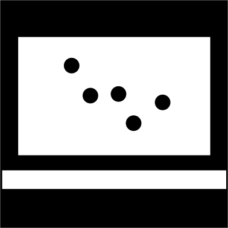
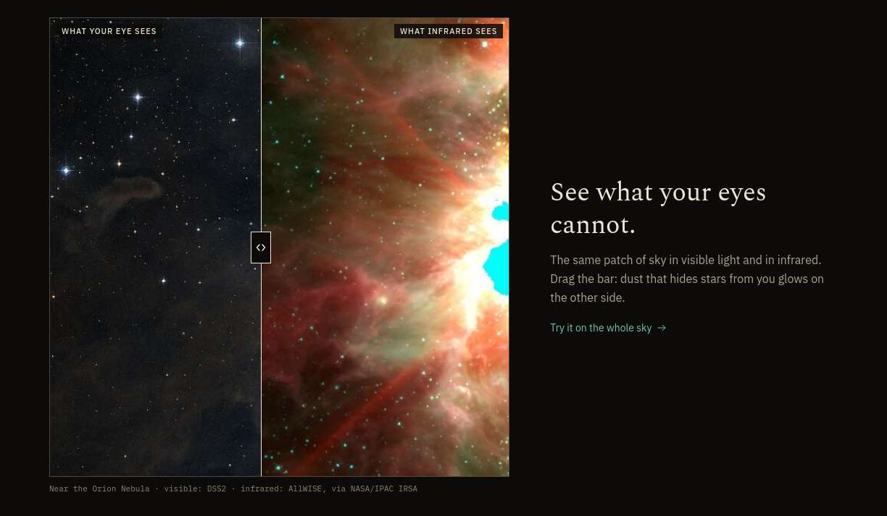
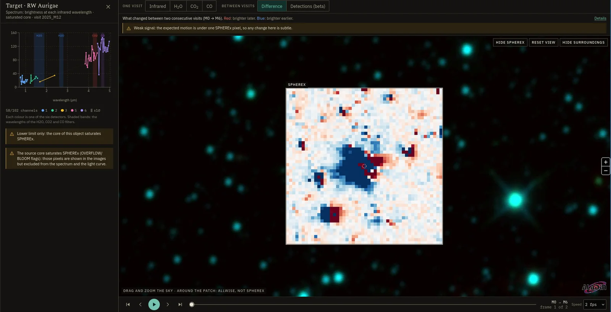
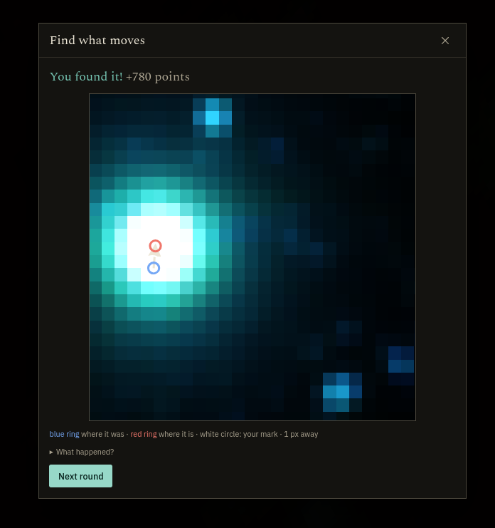
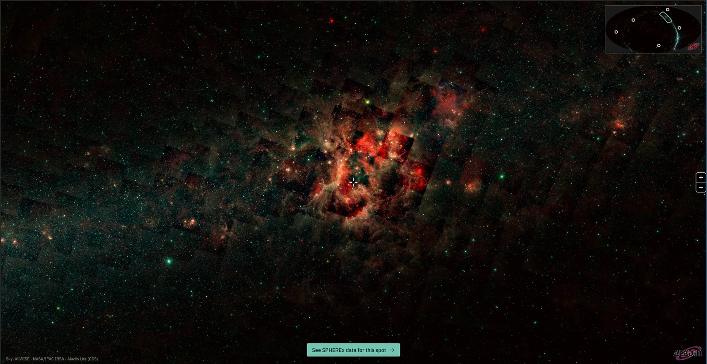

# Eskai: look up.

**Watch the infrared sky change, with real NASA SPHEREx data.**

[**Open the app at eskai.earth**](https://eskai.earth)

*Our project for the NASA Space Apps Challenge 2026, "Planet X and SPHEREx"*

The same patch of sky near the Orion Nebula: visible light (DSS2) and infrared (WISE).

---

In 1930, Clyde Tombaugh found Pluto by flicking between two photographic plates and spotting the one dot that moved. Today, NASA's **SPHEREx** maps the whole sky every six months in **102 infrared bands**. No one can search all of it alone.

**Eskai puts Tombaugh's method in anyone's hands**, with real 2026 data, and is always clear about what that data can and cannot show.

## Eskai's standout features

<video src="https://raw.githubusercontent.com/IBN-n-Drop-Table/.github/main/video/Eskai_Presentation.mp4" controls muted width="700">
  Your browser cannot play this video.
</video>

Eskai's most striking features in action. [Watch it on YouTube](https://youtu.be/8nY9VFGeb5M) if it does not play here.

## What you can do

| | |
|---|---|
| **Pick a spot** | Type RA/Dec, move the all-sky map, or tap one of the five challenge objects. Or point at the sky and ask what is above you right now. |
| **Blink the visits** | One SPHEREx image per visit, same contrast in every frame, with play, step and speed controls. |
| **Subtract them** | The difference layer shows what changed between visits: red is brighter later, blue is brighter earlier. Rings mark where a known mover should be. |
| **See the chemistry** | H₂O, CO₂ and CO filters, plus a 102-channel spectrum. In Epsilon Indi B, the methane signature shows. |
| **Eye vs infrared** | Drag a bar to compare visible light (DSS2) with infrared (AllWISE). |
| **Find what moves** | A game: two real visits flicker and you click what moved. Scored on the server against Gaia DR3 motion. |
| **Report a sighting** | Flag a candidate, let others confirm it, and share it with a card. Every view is also a link. |

<table>
<tr>
<td align="center" width="33%"> RW Aurigae, difference between two SPHEREx visits. The app warns the signal is weak and the core saturated.</td>
<td align="center" width="33%"> "Find what moves": two SPHEREx visits of Barnard's Star, with rings for where it was and is.</td>
<td align="center" width="33%"> The infrared sky map (WISE) where you pick a spot.</td>
</tr>
</table>

The "video" is 3 or 4 real visits over about a year (SPHEREx returns to a spot every 5 to 7 months), not a continuous film.

## Honest by design

Nothing is simulated, and nothing is called a discovery. You make sightings, software proposes candidates, people verify.

- Barnard's Star moves **10.3″** between the first and last visit. Gaia predicts **10.2″**. You can see it move.
- Saturated stars are shown but never measured. When there is no valid spectrum, the app says so instead of inventing one.
- If the archive is slow, you get cached data with a banner saying so, never a blank screen.

## The science notebooks

Striking images are easy. Trustworthy ones are not. [`spherex-science-notebooks`](https://github.com/IBN-n-Drop-Table/spherex-science-notebooks) is our reproducible audit of the difference imaging.

- **Five-target atlas:** the final subtraction for every challenge object, side by side.
- **Input next to output:** each first-visit image sits beside its difference product, so you can check that a signal is a real change and not an alignment or calibration artefact.
- **Strict colour code:** red brighter later, blue fainter later, black for masked pixels, so invalid regions can't pass as detections.
- **Fully offline:** the notebooks read the same files the production API serves. No database, no uploads, no network.

## The five objects

Barnard's Star, Epsilon Indi B, WISE 0855, RW Aurigae and R Draconis. All are precomputed and open instantly, each with a note on what can and can't be claimed. Anywhere else in the sky is processed live in about a minute.

## Repositories

| Repo | What it is |
|---|---|
| [**spherex-web**](https://github.com/IBN-n-Drop-Table/spherex-web) | The Eskai app: React, TypeScript, Vite and Aladin Lite. Desktop and phone. |
| [**spherex-api**](https://github.com/IBN-n-Drop-Table/spherex-api) | The backend: a FastAPI pipeline that turns SPHEREx cutouts from IRSA into visit images, differences, spectra and the game. |
| [**spherex-science-notebooks**](https://github.com/IBN-n-Drop-Table/spherex-science-notebooks) | Jupyter notebooks that audit the difference imaging for all five targets. |

## Credits

Data from **SPHEREx** (NASA/JPL/Caltech) via **NASA/IPAC IRSA**, plus WISE, Gaia DR3 (ESA), DSS2 and SIMBAD (CDS). Sky viewer: Aladin Lite. Full credits and acknowledgement are in the app.

Eskai is an independent project by **IBÑ'); Drop Table \*;** and is not endorsed by NASA. Inspired by blink-comparison astronomy and citizen-science projects such as Backyard Worlds. All repositories are MIT licensed.
